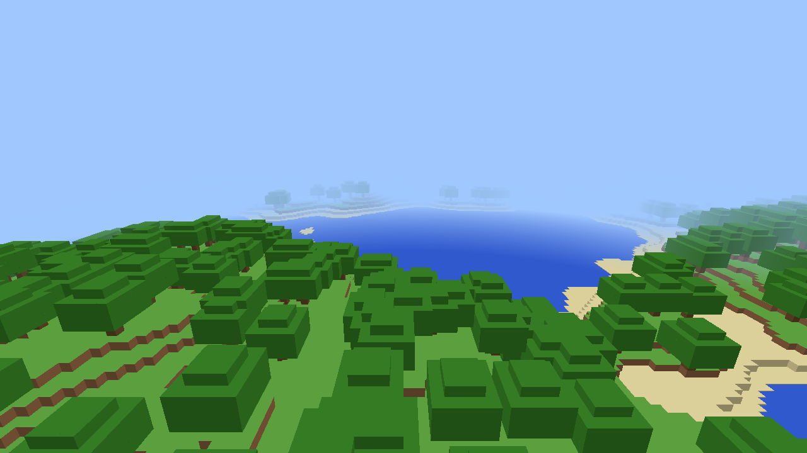

# McRust

A Minecraft: Java Edition compatible **client** written from scratch in Rust.
The goal is to connect to normal vanilla, Paper and Fabric servers and replace
the Java client entirely, without running the JVM.



> Status: early foundation. It renders an offline, procedurally generated test
> world and can query real servers' status. It cannot join servers yet; see
> the roadmap below.

## Download

Every push is built by GitHub Actions for Windows, Linux and macOS.

- **Latest build:** open the repository's **Actions** tab, click the newest
  green **Build** run, and download `mcrust-windows-x64` (or your platform)
  under *Artifacts*. You need to be signed in to GitHub. The download is a zip
  containing `mcrust.exe`.
- **Releases:** pushing a tag such as `v0.1.0` publishes the zips on the
  repository's **Releases** page, where anyone can download them.

Windows SmartScreen may warn about an unsigned app. Click *More info*, then
*Run anyway*.

## Building from source

Requires a recent stable Rust toolchain and a GPU with Vulkan, Metal, DX12 or
OpenGL support.

```bash
cargo run --release -p mcrust
```

| Key | Action |
| --- | --- |
| Mouse | Look |
| W A S D | Move |
| Space / Left Shift | Fly up / down |
| Left Ctrl (held) | Fly faster |
| Esc | Release / grab mouse |

Ping a real server (the same query as the multiplayer server list):

```bash
cargo run --release -p mcrust -- ping mc.hypixel.net
```

## Layout

| Crate | Purpose |
| --- | --- |
| `crates/protocol` | Network protocol: VarInts, strings, packet framing, Server List Ping |
| `crates/world` | Block and chunk storage, test terrain generator, chunk mesher |
| `crates/client` | `mcrust` binary: window and input (winit), rendering (wgpu), camera |

## Roadmap

Rough order. Each step is useful on its own.

1. **Rendering foundation** ✅: window, wgpu pipeline, depth buffer, fog,
   face-culled chunk meshing, fly camera.
2. **Server status** ✅: handshake and status/ping (`mcrust ping`).
3. **Login (offline-mode servers)**: Login Start, Set Compression (zlib),
   Login Success, then the Configuration state (registry data, known packs,
   finish configuration).
4. **Play state**: keep-alives, join game, receiving *Chunk Data and Update
   Light*. That means decoding NBT, paletted containers and block-state IDs
   (generated from the vanilla data reports), then rendering the server's
   world instead of the test terrain.
5. **Player movement**: send position/rotation, gravity and AABB collision
   against blocks, sprinting and sneaking.
6. **Assets**: load textures, block models and blockstates from the player's
   *own* Minecraft client jar or resource packs. Mojang's assets can't be
   redistributed, so they are never committed here. This step adds a texture
   atlas, UVs, and transparent/cutout render passes.
7. **Entities**: spawn, move and destroy packets; models for players and mobs.
8. **Interaction**: block breaking and placing, inventory, hotbar, chat.
9. **UI**: HUD, chat, inventory screens, main menu, server list.
10. **Online mode**: Microsoft/Xbox Live authentication, Mojang session
    server join, and AES/CFB8 encryption.
11. **Performance**: background chunk meshing threads, greedy meshing,
    frustum culling, smooth lighting and ambient occlusion.
12. **Audio, particles, weather, sky**, and the rest of the game.

## Prior art

- [minecraft.wiki: Java Edition protocol](https://minecraft.wiki/w/Java_Edition_protocol)
  is the protocol reference.
- [Pumpkin](https://github.com/Pumpkin-MC/Pumpkin) and
  [Valence](https://github.com/valence-rs/valence) are Rust servers whose
  protocol code is a useful reference.
- [Stevenarella](https://github.com/iceiix/stevenarella) and
  [Azalea](https://github.com/azalea-rs/azalea) are Rust client and bot
  projects.

## Legal

McRust is not affiliated with Mojang or Microsoft. "Minecraft" is a trademark
of Mojang Studios. This project contains no Mojang code or assets.
